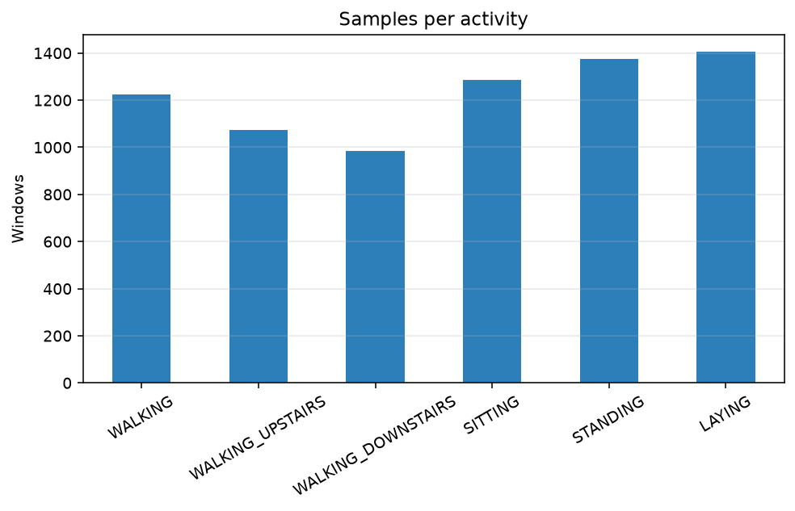

# Human Activity Recognition from Smartphone Sensors

<p align="center">
  <b>Classify what someone is doing from a waist-mounted phone IMU — walking, stairs, sitting, standing, or laying — at ~95% on held-out people.</b>
</p>

<p align="center">
  <a href="https://github.com/juandapradam12/HumanActivityRecognition/actions/workflows/ci.yml"></a>
  
  
  
  <a href="https://archive.ics.uci.edu/ml/datasets/human+activity+recognition+using+smartphones"></a>
</p>

Build a production-minded HAR pipeline on the classic [UCI Human Activity Recognition Using Smartphones](https://archive.ics.uci.edu/ml/datasets/human+activity+recognition+using+smartphones) dataset:

| What you get | Detail |
|---|---|
| **Teaching core** | k-Nearest Neighbors implemented from scratch (matches scikit-learn) |
| **Classical ML zoo** | Logistic regression, SVMs, forests, gradient boosting, sit/stand specialist |
| **Deep baseline** | 1D CNN on raw 9×128 IMU windows — competitive with engineered features |
| **Honest metrics** | Official UCI test + leave-one-subject-out (not just leaked random splits) |
| **Ship path** | Export (`joblib`), CLI predict, Streamlit demo, pytest + GitHub Actions CI |

<p align="center">
  
</p>

---

## Headline results

Evaluated on **held-out volunteers** (official UCI test) and **leave-one-subject-out** on the 21 training subjects.

| Approach | Input | Official test | LOSO |
|---|---|---:|---:|
| **Logistic Regression** | 561 handcrafted features | **95.55%** | **93.65%** |
| Cascaded HGB + Sit/Stand | 561 features | 95.18% | — |
| **1D CNN** | raw IMU (9 × 128) | **94.64%** | **92.78%** |
| Extra Trees | 561 features | 94.13% | 92.53% |
| Hist Gradient Boosting | 561 features | 93.59% | 92.93% |
| KNN (k=5) | 561 features | 88.02% | — |

> A naive shuffled hold-out of training windows can still show ~99%. That number is **optimistic** (same-person windows leak across folds). Prefer the official / LOSO figures above.

Almost every remaining mistake is **sitting ↔ standing** — the pair that looks alike on a waist IMU when the body is still. A dedicated specialist cuts that error to **~5.7%** on the official test set.

<p align="center">
  
</p>

---

## Why this project

Smartphones already carry the sensors for:

- Fitness & rehab coaching  
- Sedentary / posture awareness  
- Context-aware UX (adapt notifications to motion)  
- Privacy-friendly sensing — **no camera required**

This repository is a clean end-to-end case study: explore the data, implement a classic algorithm by hand, benchmark modern classical models, add a deep baseline on raw signals, and evaluate the way papers actually should — **by subject**, not by randomly shuffled windows.

---

## Six activities

| ID | Label | Intuition |
|---:|---|---|
| 1 | WALKING | Dynamic, periodic body motion |
| 2 | WALKING_UPSTAIRS | Higher vertical effort / frequency cues |
| 3 | WALKING_DOWNSTAIRS | Distinct impact pattern |
| 4 | SITTING | Static — hard to separate from standing |
| 5 | STANDING | Static — shares gravity pose with sitting |
| 6 | LAYING | Orientation / gravity flip |

Dataset: 30 volunteers, Samsung Galaxy S II on the waist, 50 Hz accelerometer + gyroscope, 2.56 s windows (50% overlap) → **7,352 train** and **2,947 test** labeled windows.

<p align="center">
  
</p>

---

## Quick start

### 1. Setup

```bash
git clone https://github.com/juandapradam12/HumanActivityRecognition.git
cd HumanActivityRecognition

python -m venv .venv
source .venv/bin/activate          # Windows: .venv\Scripts\activate
pip install -r requirements.txt
pip install -e .

# Tabular UCI files (test split + subject IDs)
python scripts/download_data.py

# Optional (~182MB): raw IMU tensors for the CNN
python scripts/download_data.py --with-raw
```

### 2. Verify

```bash
python scripts/smoke_test.py
pytest -q -m "not slow"
```

### 3. Reproduce results

```bash
# Classical models — official UCI test
python scripts/run_benchmark.py --protocol official --skip-custom-knn

# Subject-independent CV
python scripts/run_benchmark.py --protocol loso --skip-custom-knn

# Features vs 1D CNN (official + LOSO)
python scripts/run_deep_baseline.py
```

### 4. Demo & export

```bash
python scripts/export_model.py
python scripts/predict.py --input X_test.txt
streamlit run app/streamlit_app.py
jupyter notebook "Human Activity Recognition.ipynb"
```

---

## Repository layout

```text
HumanActivityRecognition/
├── README.md                          ← you are here
├── Human Activity Recognition.ipynb   ← narrative: EDA → homemade KNN → models
├── app/streamlit_app.py               ← interactive demo
├── src/har/                           ← installable library
│   ├── data.py                        # official splits + labels
│   ├── raw_data.py                    # raw 9×128 IMU windows
│   ├── knn.py                         # from-scratch vectorized k-NN
│   ├── models.py                      # zoo, cascade, sit/stand specialist
│   ├── cnn.py                         # PyTorch 1D CNN
│   ├── evaluate.py                    # official test + LOSO
│   ├── export.py                      # joblib persistence
│   └── plots.py                       # charts
├── scripts/
│   ├── download_data.py               # UCI fetch (+ --with-raw)
│   ├── run_benchmark.py               # holdout | official | loso
│   ├── run_deep_baseline.py           # features vs CNN
│   ├── export_model.py / predict.py
│   └── smoke_test.py
├── tests/                             ← pytest
├── docs/
│   ├── DOCUMENTATION.md               # full methodology
│   ├── MODEL_CARD.md                  # model card
│   ├── WALKTHROUGH.md                 # guided tour
│   └── assets/                        # result figures
├── X_*.txt  y_*.txt  subject_*.txt    # UCI partitions
└── .github/workflows/ci.yml
```

---

## Documentation

| Doc | Contents |
|---|---|
| [`docs/DOCUMENTATION.md`](docs/DOCUMENTATION.md) | Dataset, algorithms, evaluation, API, reproducibility |
| [`docs/MODEL_CARD.md`](docs/MODEL_CARD.md) | Intended use, metrics, data, limitations, ethics |
| [`docs/WALKTHROUGH.md`](docs/WALKTHROUGH.md) | Step-by-step tour of the codebase and experiments |
| Notebook | Interactive EDA + homemade KNN story |

---

## Method snapshot

```text
Smartphone IMU @ 50 Hz
        │
        ├─► UCI 561-D features  ──► Classical zoo / cascade  ──► ~95.6% official
        │
        └─► Raw 9 × 128 window  ──► 1D CNN (PyTorch)         ──► ~94.6% official
```

**Evaluation discipline**

1. `official` — train on 21 people, test on 9 held-out people  
2. `loso` — rotate each training volunteer out as the test subject  
3. `holdout` — random window split (teaching only; overestimates)

**Hard pair:** sitting vs standing → calibrated RBF-SVM specialist + optional cascade.

---

## Library usage

```python
from har.data import load_official_splits
from har.models import CascadedHARClassifier, build_model_zoo
from har.evaluate import evaluate_on_official_test

train, test = load_official_splits()

model = CascadedHARClassifier().fit(train.X, train.y)
print(model.predict(test.X[:5]))

leaderboard = evaluate_on_official_test(
    build_model_zoo(include_custom_knn=False)
)
print(leaderboard[["model", "accuracy", "sitting_standing_error"]])
```

Raw-signal CNN:

```python
from har.cnn import train_eval_official

result, metrics, preds = train_eval_official(epochs=25)
print(metrics)
```

---

## Limitations (read these)

- **Waist placement only** — pocket / hand / bag will shift the distribution.  
- **Segmented windows** — UCI already cuts 2.56 s slices; this is not a full always-on detector.  
- **Sit ↔ stand confusion** remains the main error mode, especially for the CNN.  
- **Subject leakage** if you only quote random hold-out accuracy.

---

## Citation

If you use the dataset, please cite the original authors:

```bibtex
@inproceedings{anguita2013public,
  title={A Public Domain Dataset for Human Activity Recognition Using Smartphones},
  author={Anguita, Davide and Ghio, Alessandro and Oneto, Luca and
          Parra, Xavier and Reyes-Ortiz, Jorge L.},
  booktitle={ESANN},
  year={2013}
}
```

Code in this repository is provided for **educational and research** use.

---

## License & credit

Sensor data © UCI HAR authors (Reyes-Ortiz, Anguita, Ghio, Oneto, Parra).  
Project code and documentation by Juan David Prada Malagón.
