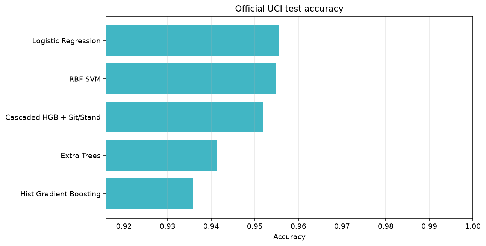
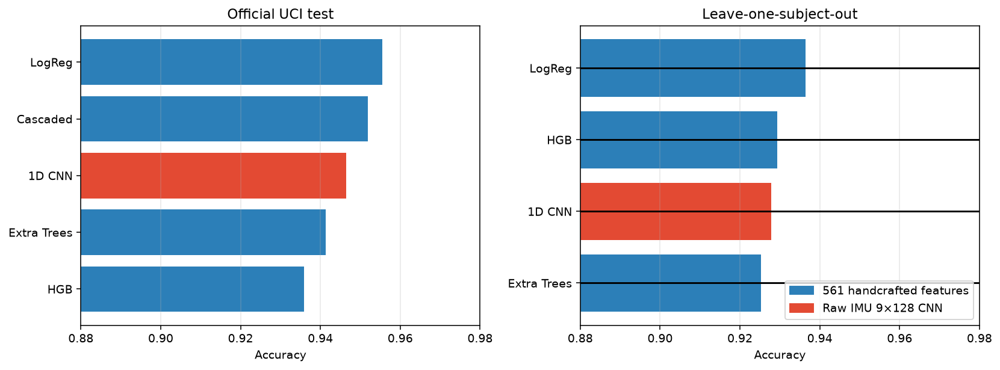
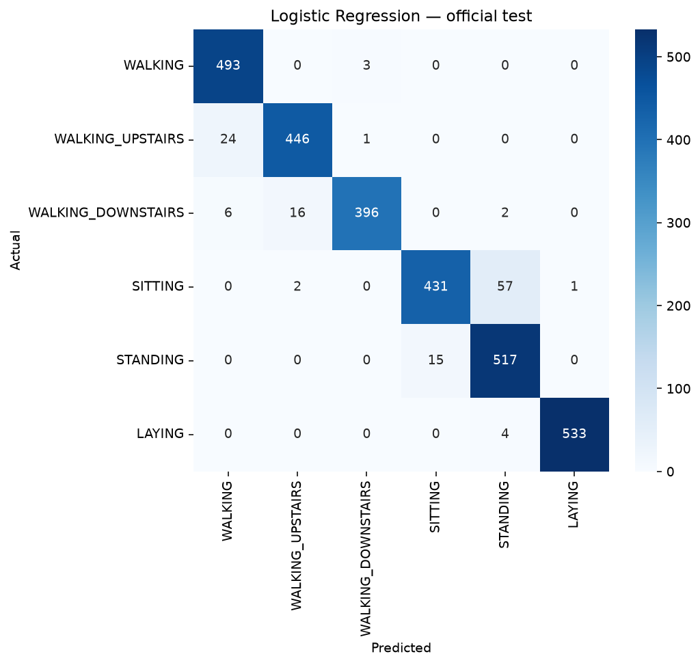
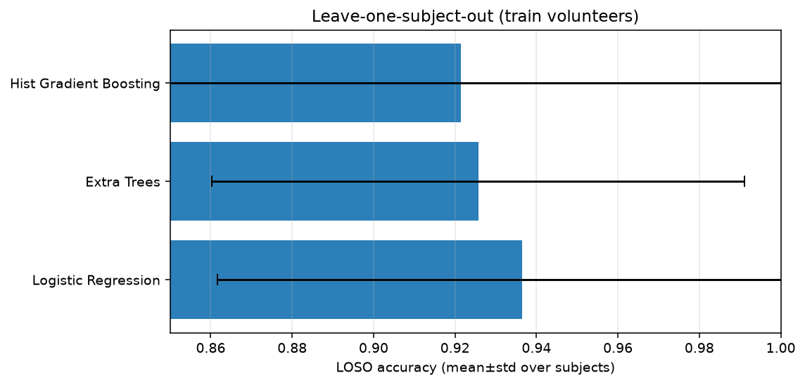

# Human Activity Recognition from Smartphone Sensors

> Turn waist-mounted accelerometer & gyroscope readings into a real-time guess of what someone is doing — walking, climbing stairs, sitting, standing, or lying down.

[](https://github.com/juandapradam12/HumanActivityRecognition/actions/workflows/ci.yml)
[](https://www.python.org/)
[](https://scikit-learn.org/)
[](https://archive.ics.uci.edu/ml/datasets/human+activity+recognition+using+smartphones)

Classify human activity from the classic [UCI HAR Using Smartphones](https://archive.ics.uci.edu/ml/datasets/human+activity+recognition+using+smartphones) dataset: **7,352 train + 2,947 test windows**.

This repo combines a **teaching notebook** (k-NN from scratch), a **rigorous classical-ML benchmark** (official test + LOSO), and a **raw-IMU 1D CNN** so you can compare handcrafted features vs learned representations side by side.

<p align="center">
  
</p>

---

## Results card

### Official UCI test (train → held-out volunteers)

| Model | Accuracy | Weighted F1 | Sit↔Stand error |
|---|---:|---:|---:|
| **Logistic Regression** | **0.9555** | **0.9555** | 0.0704 |
| RBF SVM | 0.9549 | 0.9547 | 0.0635 |
| Cascaded HGB + Sit/Stand | 0.9518 | 0.9517 | **0.0567** |
| Extra Trees | 0.9413 | 0.9409 | 0.0616 |
| Hist Gradient Boosting | 0.9359 | 0.9356 | 0.1026 |
| sklearn KNN (k=5) | 0.8802 | 0.8790 | 0.1457 |

Sitting/standing binary specialist (official test): **94.2%** accuracy.

### Leave-one-subject-out (21 training volunteers)

| Model | Overall acc. | Mean±std (subject) | Sit↔Stand error |
|---|---:|---:|---:|
| **Logistic Regression** | **0.9365** | 0.9355 ± 0.0748 | 0.0831 |
| Extra Trees | 0.9257 | 0.9258 ± 0.0654 | 0.1000 |
| Hist Gradient Boosting | 0.9214 | 0.9229 ± 0.0802 | 0.1109 |

### Features vs raw-IMU 1D CNN

Same protocols, different inputs: **561 engineered features** vs **9 × 128 raw accelerometer/gyro windows**.

| Model | Input | Official test | LOSO |
|---|---|---:|---:|
| Logistic Regression | handcrafted 561 | **0.9555** | **0.9365** |
| Cascaded HGB + Sit/Stand | handcrafted 561 | 0.9518 | — |
| **1D CNN** | **raw IMU 9×128** | **0.9464** | **0.9278** |
| Extra Trees | handcrafted 561 | 0.9413 | 0.9253 |
| Hist Gradient Boosting | handcrafted 561 | 0.9359 | 0.9293 |

The CNN is competitive **without** the UCI feature pipeline — locomotion classes are near-perfect; residual errors still concentrate on sitting ↔ standing.

<p align="center">
  
</p>

<p align="center">
  
  
</p>

### Why random hold-out looked like 99%

A shuffled 70/30 split of *training windows* can hit ~99% because windows from the same person leak across folds. **Official test (~95.5%)** and **LOSO (~93.7%)** are the credible numbers for this project.

---

## Quick start

```bash
python -m venv .venv
source .venv/bin/activate
pip install -r requirements.txt
pip install -e .

# Ensure official test + subject files are present
python scripts/download_data.py
# Optional: raw IMU windows for the CNN baseline (~182MB)
python scripts/download_data.py --with-raw

# Smoke + unit tests
python scripts/smoke_test.py
pytest -q

# Official UCI test leaderboard
python scripts/run_benchmark.py --protocol official --skip-custom-knn

# Leave-one-subject-out
python scripts/run_benchmark.py --protocol loso --skip-custom-knn

# Features vs 1D CNN (official + LOSO)
python scripts/run_deep_baseline.py

# Export a model and predict
python scripts/export_model.py
python scripts/predict.py --input X_test.txt

# Interactive demo
streamlit run app/streamlit_app.py

# Teaching notebook
jupyter notebook "Human Activity Recognition.ipynb"
```

---

## What’s inside

```
├── Human Activity Recognition.ipynb   # EDA → homemade KNN → model zoo
├── app/streamlit_app.py               # Interactive demo
├── src/har/                           # Library
│   ├── data.py                        # Official splits + subjects
│   ├── raw_data.py                    # Raw 9×128 IMU windows
│   ├── knn.py                         # Vectorized from-scratch k-NN
│   ├── models.py                      # Zoo, cascade, sit/stand specialist
│   ├── cnn.py                         # PyTorch 1D CNN baseline
│   ├── evaluate.py                    # Official test + LOSO protocols
│   ├── export.py                      # joblib save/load
│   └── plots.py
├── scripts/
│   ├── download_data.py               # Fetch UCI files (+ --with-raw)
│   ├── run_benchmark.py               # holdout | official | loso
│   ├── run_deep_baseline.py           # Features vs CNN comparison
│   ├── export_model.py / predict.py
│   └── smoke_test.py
├── tests/                             # pytest suite
├── docs/DOCUMENTATION.md
├── docs/assets/                       # Result figures
├── X_*.txt y_*.txt subject_*.txt      # UCI partitions
└── .github/workflows/ci.yml
```

---

## Highlights

- **From-scratch KNN** matching scikit-learn Euclidean predictions
- **Official test + LOSO** — not just optimistic random hold-outs
- **Raw-IMU 1D CNN** competitive with 561-D engineered features
- **Sitting/standing specialist** + cascaded classifier to cut the hard-pair error
- **Calibrated probabilities** for thresholded / demo use
- **Export + CLI predict** (`joblib`) and **Streamlit** playground
- **CI** (smoke test, pytest, quick official benchmark)

---

## Limitations

- Sensors are **waist-mounted only** — hand / pocket placements differ.
- The CNN uses **fixed 2.56 s windows** already segmented by UCI (not a full streaming detector).
- Random window splits **overestimate** generalization; prefer official / LOSO numbers above.
- Residual errors concentrate on **sitting ↔ standing** (worse for the CNN than for feature models).

See [`docs/DOCUMENTATION.md`](docs/DOCUMENTATION.md) for methodology and design notes.

---

## Activities

| ID | Activity |
|---:|---|
| 1 | WALKING |
| 2 | WALKING_UPSTAIRS |
| 3 | WALKING_DOWNSTAIRS |
| 4 | SITTING |
| 5 | STANDING |
| 6 | LAYING |

---

## License & data credit

Code is provided for educational and research use. Sensor data © UCI HAR authors (Reyes-Ortiz, Anguita, Ghio, Oneto, Parra):

> Davide Anguita, Alessandro Ghio, Luca Oneto, Xavier Parra and Jorge L. Reyes-Ortiz.  
> *A Public Domain Dataset for Human Activity Recognition Using Smartphones.* ESANN 2013.
